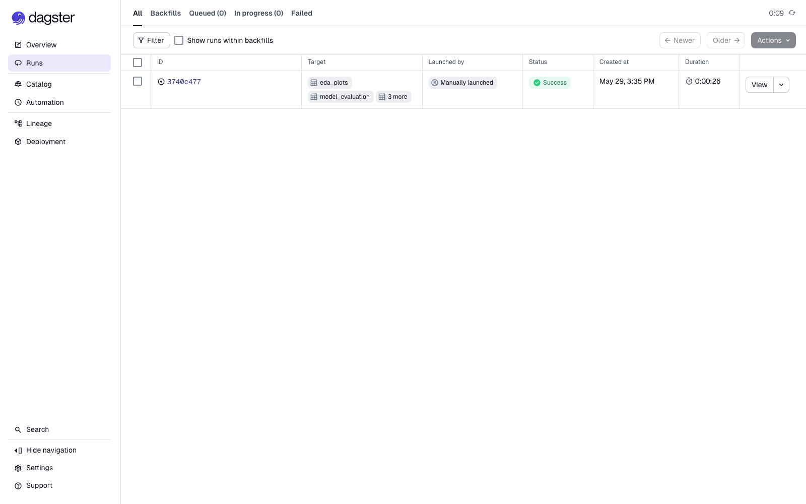
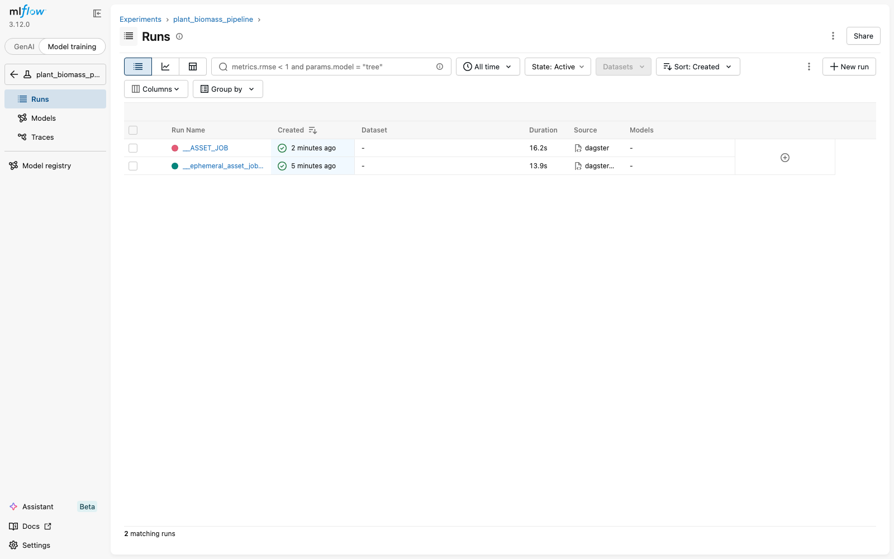

# MLOps Lab Block 2 — Dagster + MLflow Pipeline

## 1. Pipeline Architecture

Five Dagster assets are defined in `dagster_pipeline.py`:

```
raw_dataset ──► preprocessed_data ──► trained_model ──► model_evaluation
     └──────────► eda_plots
```

| Asset | Input | Output |
|---|---|---|
| `raw_dataset` | – | metadata DataFrame + image paths |
| `preprocessed_data` | `raw_dataset` | train/val PyTorch DataLoaders (80/20 plant-disjoint split) |
| `eda_plots` | `raw_dataset` | target distribution + biomass vs. age figures |
| `trained_model` | `preprocessed_data` | trained ResNet18 weights + per-epoch metrics |
| `model_evaluation` | `trained_model`, `preprocessed_data` | val metrics, training curves, parity plot |

MLflow tracking is integrated via the official `dagster-mlflow` resource. Each run logs:

- **9 parameters:** `epochs`, `batch_size`, `learning_rate`, `model_name`, `image_size`, `freeze_backbone`, `max_train_batches`, `n_train`, `n_val`
- **6 metrics:** `train_mse`, `val_mse`, `train_mae`, `val_mae` (per epoch), `final_val_mse`, `final_val_mae`
- **Artifacts:** model checkpoint (`model.pt`), training curves, parity plot, metrics file

## 2. Setup Instructions

```bash
python3 -m venv venv
source venv/bin/activate
pip install -r requirements.txt
```

Place the dataset folder `mlops_biomass_data/` next to `dagster_pipeline.py`, or set the environment variable:

```bash
export BIOMASS_DATA_DIR=/path/to/mlops_biomass_data
```

Required packages: `dagster`, `dagster-webserver`, `dagster-mlflow`, `mlflow`, `torch`, `torchvision`, `pandas`, `matplotlib`, `Pillow`, `openpyxl`, `scikit-learn`

## 3. Running the Pipeline

**Dagster UI (recommended):**

```bash
export DAGSTER_HOME="$(pwd)/.dagster_home"
dagster dev -f dagster_pipeline.py
# Open http://localhost:3000 → Lineage → "Materialize all"
```

**Dagster CLI:**

```bash
export DAGSTER_HOME="$(pwd)/.dagster_home"
dagster asset materialize -f dagster_pipeline.py --select '*'
```

**Programmatic:**

```bash
python dagster_pipeline.py
```

**MLflow UI:**

```bash
mlflow ui --backend-store-uri sqlite:///mlflow.db
# Open http://localhost:5000 → experiment "plant_biomass_pipeline"
```

## 4. Results

### Dagster — successful run



### MLflow — experiments



**Tracked metrics (2-epoch run, 15 batches/epoch):**

| Metric | Value |
|---|---|
| n_train | 2,931 |
| n_val | 753 |
| Best val MSE | 0.0660 g² |
| Final val MAE | 0.176 g |
| Target std on val | 0.296 g |

## 5. Implemented Improvements (Lab Session 2)

During the joint improvement session we added the two enhancements suggested on
the task sheet — **configurable options via Dagster config classes/launchpad**
and **plots & metrics surfaced directly in Dagster**.

### Configurable options (Config classes + launchpad)

The previously hard-coded `TrainConfig` constant was replaced by two
`dagster.Config` classes in `dagster_pipeline.py`:

- `PreprocessConfig` — `image_size`, `batch_size`, `val_fraction`, `seed`, `num_workers`
- `TrainingConfig` — `epochs`, `learning_rate`, `model_name`, `freeze_backbone`, `max_train_batches`, `seed`

Every field keeps a default, so **"Materialize all" still works without any
config**, while the **launchpad** now lets you override each value per run
(e.g. switch `model_name` to `resnet50` or raise `epochs`). Example launchpad
config:

```yaml
ops:
  preprocessed_data:
    config:
      batch_size: 16
      image_size: 128
  trained_model:
    config:
      epochs: 5
      model_name: resnet50
```

### Plots & metrics in Dagster

Each asset now attaches metadata via `context.add_output_metadata(...)`, so the
numbers and figures show up on the **asset detail / materialization view** in the
Dagster UI (not only in MLflow):

- `raw_dataset` — row/image counts, target mean/std, missing-value count
- `preprocessed_data` — `n_train`, `n_val`, effective `batch_size` / `image_size`
- `eda_plots` — target-distribution and biomass-vs-age plots embedded inline
- `trained_model` — `best_val_mse`, last-epoch metrics, hyper-parameters, model path
- `model_evaluation` — `final_val_mse` / `final_val_mae` plus the training-curve and parity plots embedded inline

Numeric metadata (e.g. `best_val_mse`) is also plotted by Dagster across
materializations, giving a quick history view next to MLflow.

### Screenshot


