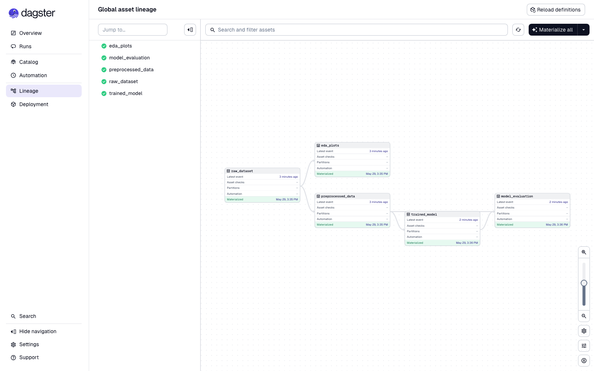
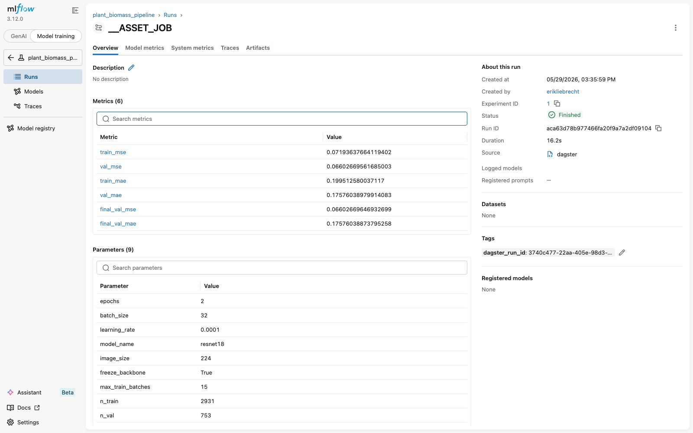

# MLOps Lab Block 2 — Dagster + MLflow Pipeline

This block converts the manual Block 1 workflow (image-based regression of
`fresh_weight_total` with a ResNet) into an automated Dagster pipeline whose
training step is tracked with MLflow.

## 1. Pipeline architecture

Five Dagster assets, registered in `dagster_pipeline.py`:

```
raw_dataset ─► preprocessed_data ─► trained_model ─► model_evaluation
       │                                  ▲
       └──────────► eda_plots             │
                                          │
                  (MLflow logs params, metrics, model artifact)
```

| Asset | Input | Output | What it does |
|---|---|---|---|
| `raw_dataset` | – | `{"metadata": DataFrame, "image_paths": list, "image_dir": str}` | Reads `digital_biomass_labels.xlsx` and lists the image files |
| `preprocessed_data` | `raw_dataset` | `{"train_loader": DataLoader, "val_loader": DataLoader, ...}` | Plant-disjoint 80/20 split, ImageNet normalisation, light augmentation, builds PyTorch DataLoaders |
| `eda_plots` (optional) | `raw_dataset` | dict of paths | Two EDA figures: target distribution + biomass vs. age |
| `trained_model` | `preprocessed_data` | `{"model_state_dict", "history", "best_val_mse", "config"}` | Trains a frozen-backbone ResNet18 and logs params, per-epoch metrics, and the model checkpoint to MLflow |
| `model_evaluation` | `trained_model`, `preprocessed_data` | `{"val_mse", "val_mae", paths…}` | Re-evaluates on the val set, writes training curves, a parity plot, `metrics.txt`, and logs all of them as MLflow artifacts |

Reusable training code (`BiomassDataset`, `build_model`, `run_epoch`, …)
lives in `training_utils.py` so the assets stay short.

The MLflow resource is the official Dagster integration:

```python
defs = Definitions(
    assets=[raw_dataset, preprocessed_data, eda_plots,
            trained_model, model_evaluation],
    resources={
        "mlflow": mlflow_tracking.configured({
            "experiment_name": "plant_biomass_pipeline",
            "mlflow_tracking_uri": "sqlite:///mlflow.db",
        }),
    },
)
```

A single MLflow run is opened per pipeline run by the `dagster-mlflow`
resource and is shared across `trained_model` and `model_evaluation`.

## 2. What is logged to MLflow

Required by the assignment: ≥3 parameters, ≥2 metrics, model artifact. The
pipeline actually logs:

- **9 parameters**: `epochs`, `batch_size`, `learning_rate`, `model_name`,
  `image_size`, `freeze_backbone`, `max_train_batches`, `n_train`, `n_val`.
- **6 metrics**: `train_mse`, `val_mse`, `train_mae`, `val_mae` (per epoch),
  `final_val_mse`, `final_val_mae` (post-training evaluation).
- **Artifacts**: `model/model.pt` (the trained weights), plus
  `evaluation/training_curves.png`, `evaluation/parity_plot.png`,
  `evaluation/metrics.txt`.

## 3. Setup

```bash
# 1. Create the venv and install dependencies
python3 -m venv venv
source venv/bin/activate
pip install -r requirements.txt

# 2. Place the dataset next to the pipeline (or symlink it):
#    mlop_praktikum2/mlops_biomass_data/
#       ├── digital_biomass_labels.xlsx
#       └── images_med_res/   # 4,294 PNGs
#
# An alternative location can be passed via the environment variable
# BIOMASS_DATA_DIR=/path/to/mlops_biomass_data
```

Required packages (in `requirements.txt`): `dagster`, `dagster-webserver`,
`dagster-mlflow`, `mlflow`, `torch`, `torchvision`, `pandas`, `matplotlib`,
`Pillow`, `openpyxl`, `scikit-learn`.

## 4. Running the pipeline

There are three equivalent ways to run it.

### a) Dagster UI (recommended)

```bash
export DAGSTER_HOME="$(pwd)/.dagster_home"
dagster dev -f dagster_pipeline.py
# Open http://localhost:3000 → Lineage → "Materialize all"
```

### b) Dagster CLI

```bash
export DAGSTER_HOME="$(pwd)/.dagster_home"
dagster asset materialize -f dagster_pipeline.py --select '*'
```

### c) Programmatic

```bash
python dagster_pipeline.py
```

### MLflow UI

```bash
mlflow ui --backend-store-uri sqlite:///mlflow.db
# Open http://localhost:5000 → experiment "plant_biomass_pipeline"
```

## 5. Results

### Dagster lineage with all assets materialized



All five assets materialised successfully (green check). The dependency graph
matches the table in §1: `raw_dataset` fans out to `eda_plots` and
`preprocessed_data`; `model_evaluation` joins `trained_model` and
`preprocessed_data`.

### Dagster runs view


### MLflow experiments — runs list


Two completed runs are visible in the `plant_biomass_pipeline` experiment
(one launched programmatically, one via the `dagster asset materialize`
CLI). Both show **Status = Finished**.

### MLflow — run detail



The run detail page shows all six metrics, nine parameters, and the
`dagster_run_id` tag that the `dagster-mlflow` resource automatically
attaches.

### Training curves (asset output)


### Parity plot — predicted vs actual on the validation set


### EDA assets


### Final numbers

The pipeline default is a quick 2-epoch run, capped at 15 training batches
per epoch (~480 images), as suggested by the lab sheet ("start with a small
data subset and few epochs for faster iterations").

| Metric | Value |
|---|---|
| n_train (plants used during training) | 2,931 |
| n_val | 753 |
| Best val MSE | 0.0660 g² |
| Final val MAE | 0.176 g |
| Target std on val | 0.296 g |

Full per-epoch numbers are in `results/metrics.txt`.

## 6. Tips and gotchas (encountered during the lab)

- The `dagster-mlflow` resource opens an MLflow run per pipeline run. Don't
  wrap your asset body in another `mlflow.start_run()` — call
  `mlflow.log_param/metric/artifact` directly on the active run.
- Use a persistent `DAGSTER_HOME` so the UI shows materialisation history.
  Without it, every `dagster dev` start is empty.
- On Apple Silicon, set `num_workers=0` in the DataLoader to avoid the
  occasional macOS / MPS worker hang.
- Keep asset return values pickleable (DataFrames, dicts of tensors are
  fine) because the default Dagster IO manager pickles them between steps.

## 7. File structure

```
mlop_praktikum2/
├── README.md                   # this file
├── README.pdf                  # PDF export
├── dagster_pipeline.py         # 5 Dagster assets + MLflow resource
├── training_utils.py           # reusable Dataset, model, train loop
├── take_screenshots.py         # headless screenshot helper
├── requirements.txt
├── mlflow.db                   # SQLite MLflow tracking store
├── figures/                    # EDA outputs (asset eda_plots)
├── results/                    # model.pt, training_curves.png, parity_plot.png, metrics.txt
├── screenshots/                # Dagster + MLflow UI screenshots
└── .dagster_home/              # persistent Dagster instance (gitignore)
```
